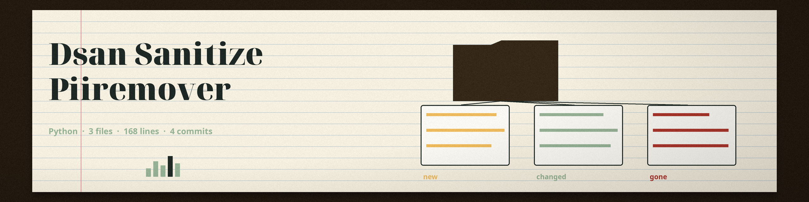

# dsan-sanitize-PIIRemover
A command-line tool that removes Personally Identifiable Information (PII) from text-based files. Detection uses four regular expressions only: one for social security numbers (3-2-4 dashed digits), one for phone numbers, one for email addresses, and one for card numbers written as a run of 13 or more digits, including runs longer than 16 digits, in contiguous, dashed, or spaced form. No machine learning model is used, and no other PII types (such as names or addresses) are detected. Every match is replaced with the redaction string.

## Install
`git clone https://github.com/ShadowStrikeHQ/dsan-sanitize-piiremover`

## Usage
`python main.py -i <input_file> -o <output_file> [options]`

A run is refused at exit 1 when the output path resolves to the input file, including ./ alias and symlink spellings.

## Parameters
- `-h`: Show help message and exit
- `-i`: Path to the input text file.
- `-o`: Path to the output text file.
- `-r`: Replacement string for PII (default: <REDACTED>)
- `--no-ssn`: Disable SSN removal.
- `--no-phone`: Disable phone number removal.
- `--no-email`: Disable email address removal.
- `--no-credit-card`: Disable credit card number removal.

## License
Copyright (c) ShadowStrikeHQ
